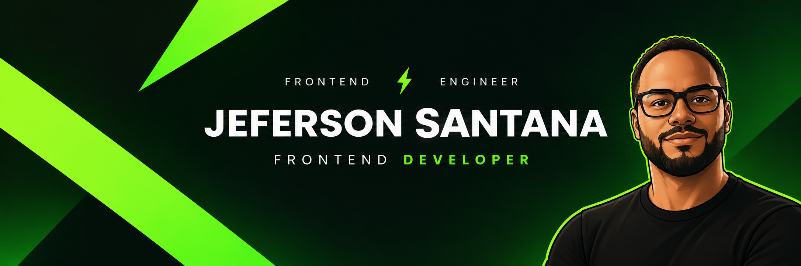
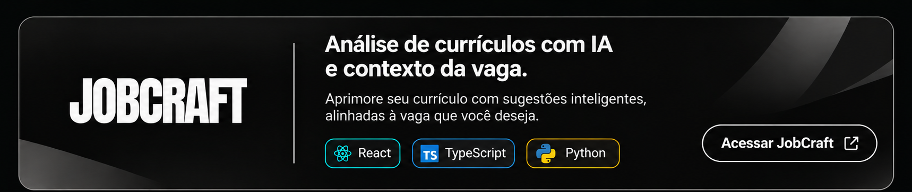

<!--
  GitHub Profile — Jeferson Santana
  Tema: Developer Terminal 2.0 | dark + neon green
  Assets: ./assets/header-terminal-animated.gif
-->

<div align="center">

  


  <p><samp>arquitetura frontend / qualidade / performance / experiência de produto</samp></p>

</div>

---

## `~/profile` $ whoami

Sou desenvolvedor **front-end**, com experiência na construção e evolução de aplicações web utilizando **Angular, React, Next.js, Vue.js e TypeScript**.

Atualmente, trabalho na **Claps**, com foco em aplicações modernas, integração com APIs e arquiteturas de microfrontends. Ao longo da minha trajetória, tenho atuado com **design systems, componentização, modernização de aplicações e qualidade de software**.

Para mim, um bom front-end vai além de criar telas: envolve tomar decisões técnicas que tornam o produto mais **rápido, acessível, consistente e fácil de manter**.

```ts
const developer = {
  name: "Jeferson Santana",
  role: "Frontend Engineer",
  building: ["Scalable frontend", "Design systems", "Great user experiences"],
  caresAbout: ["Architecture", "Performance", "Testing", "Accessibility"],
  exploring: ["NestJS", "Node.js", "PostgreSQL", "Prisma", "Cloud"],
  mindset: "Build with purpose. Improve continuously.",
};
```

## `~/stack` $ ls -la

**`core/` — tecnologias principais**

<p>
  
</p>

**`tooling/` — engenharia, UI e colaboração**

<p>
  
</p>

Também tenho contato com **Storybook, RxJS, APIs REST, microfrontends, testes automatizados, code review e bibliotecas de componentes**.

<details>
  <summary><strong><code>more ./stack/other-technologies.md</code> — outras tecnologias e ferramentas</strong></summary>
  <br />

  Node.js · NestJS · Nuxt · AngularJS · Radix UI · Flutter · Markdown · AWS · Firebase · Netlify · Vercel · Docker · Nginx · GitHub Actions · Jira

  > Esta lista reúne tecnologias presentes no meu repertório e em estudos; não representa o mesmo nível de experiência em todas elas.

</details>

## `~/principles` $ cat frontend.md

| Pilar | O que valorizo |
| :--- | :--- |
| **Arquitetura** | Organização por responsabilidades, baixo acoplamento e evolução sustentável. |
| **Componentização** | Interfaces consistentes, reutilizáveis e alinhadas a design systems. |
| **Qualidade** | Testes, revisão de código, legibilidade e prevenção de regressões. |
| **Experiência** | Acessibilidade, responsividade, estados de interface e performance. |
| **Produto** | Soluções que equilibram necessidades reais, usabilidade e manutenção. |

## `~/projects` $ ls featured/

Dois produtos pessoais que desenvolvo, com foco em **experiência de uso, arquitetura e soluções para problemas reais**.

<p align="center">
  <a href="https://soma.jeferson.site" title="Conhecer o Soma — finanças a dois">
    
  </a>
</p>

<p align="center">
  <a href="https://jobcraft.jeferson.site" title="Conhecer o JobCraft — currículos com inteligência artificial">
    
  </a>
</p>

<sub>Clique em um dos banners para acessar o projeto.</sub>

<p align="right">
  <a href="https://github.com/JefersonSantanaDev?tab=repositories"><strong>Ver todos os repositórios</strong></a>
</p>

<h2>~/activity $ git log --stat</h2>

<div align="center">
  
</div>

<sub>
  As estatísticas são geradas por serviços externos
  e não representam toda a atividade privada.
</sub>

## `~/contact` $ echo $CONNECT

Gosto de trocar experiências sobre **frontend, arquitetura, design systems, testes, performance e desenvolvimento de produtos**. Também estou ampliando meus conhecimentos em backend e arquitetura full-stack.

<p align="center">
  <a href="https://www.linkedin.com/in/jefersonaraujo199518/" title="Conectar no LinkedIn"></a>&emsp;&emsp;&emsp;<a href="https://github.com/JefersonSantanaDev" title="Visitar GitHub"></a>
</p>

---

<div align="center">
  <samp><strong>&gt; Construindo interfaces melhores, uma decisão técnica de cada vez._</strong></samp>
</div>
